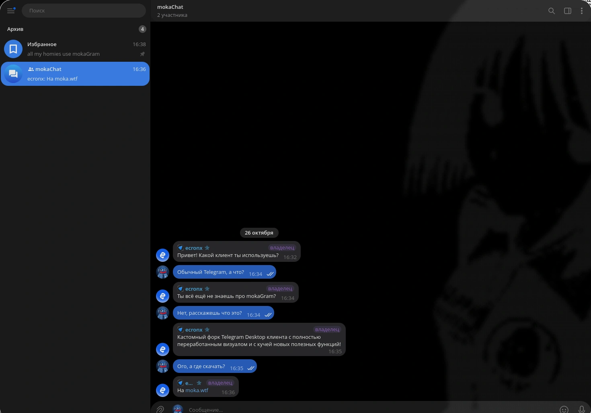

  

<h1 align="center">Mogram</h1>

  Клиент на основе Telegram Desktop с переработанным дизайном и новыми функциями.

  
  
  

  

## О проекте

**Mogram** — кастомный форк Telegram Desktop с полностью переработанным визуалом в md3-стиле и кучей новых полезных функций. Все секции в настройках лежат отдельными скруглёнными карточками, каждая функция включается отдельно, и включать нужно только то, что нужно.

Клиент работает с обычным аккаунтом Telegram и обычными серверами. Плагины из экстеры, но на ПК: свой API, нативный движок на C++ и магазин прямо в клиенте.

## Что умеет

- **Приватность**: режим стримера прячет номер, юзернейм и ID, режим призрака не отмечает прочитанным и скрывает, что ты в сети
- **Удалённые и правки** сообщений
- **Безопасность**
- **Музыка** с текстом песни и подсветкой строки
- **Быстрые команды**
- **Система**: анти-лаг и экономия в фоне
- **Кастомизация** интерфейса
- **Инструменты**: скриншот сообщений карточкой
- **Плагины** в формате `.plugin`, нативный движок и магазин прямо в клиенте

Всё лежит в одном месте: **Настройки → Настройки Mogram**. Подробно со скриншотами: [docs/FEATURES.md](docs/FEATURES.md).

## Скачать

| Система | Версия | Файл |
|---|---|---|
| **macOS Apple Silicon (arm64)** | v0.1.8 | [mokagram-arm64.dmg](https://github.com/TUHS-lab/mogram/releases/download/v0.1.8/Mogram-0.1.8-arm64.dmg) |
| **Windows** | v0.1.7 | [mokagram-win-x64.zip](https://github.com/TUHS-lab/mogram/releases/download/v0.1.7/mokagram-win-x64.zip) |
| **Linux** | v0.1.3 | [AppImage](https://github.com/TUHS-lab/mogram/releases/download/v0.1.3/mokagram-x86_64.AppImage) · [.deb](https://github.com/TUHS-lab/mogram/releases/download/v0.1.3/mokagram_0.1.3_amd64.deb) · [.rpm](https://github.com/TUHS-lab/mogram/releases/download/v0.1.3/mokagram-0.1.3-1.x86_64.rpm) · [pacman](https://github.com/TUHS-lab/mogram/releases/download/v0.1.3/mokagram-0.1.3-1-x86_64.pkg.tar.zst) · [tar.xz](https://github.com/TUHS-lab/mogram/releases/download/v0.1.3/mokagram-linux-x64.tar.xz) |

Сборка для Windows без подписи разработчика, система может предупредить при первом запуске.

## Плагины

Плагин: один файл `.plugin` с классом, наследующим `BasePlugin`. Метаданные, права и команды лежат в самом файле, лимит 300 действий в минуту, каждое действие пишется в журнал. Нативный движок на C++ выполняет поддерживаемые конструкции API без встроенного интерпретатора Python; произвольный Python-код не поддерживается.

Полное описание: [docs-plugins-api.md](docs-plugins-api.md), пример: [examples/showcase.plugin](examples/showcase.plugin).

## Сборка

Mogram собирается так же, как Telegram Desktop:

- [macOS](docs/building-mac.md)
- [Windows](docs/building-win.md)
- [GNU/Linux (Docker)](docs/building-linux.md)

Устройство репозитория: [docs/DEVELOPMENT.md](docs/DEVELOPMENT.md). Исходники Telegram Desktop и список сторонних библиотек: [telegramdesktop/tdesktop](https://github.com/telegramdesktop/tdesktop).

## Авторство и лицензия

> **Основано на Mogram, автор [@tuhss](https://t.me/tuhss) (https://t.me/tuhss). https://github.com/TUHS-lab/mogram**

Mogram основан на [Telegram Desktop](https://github.com/telegramdesktop/tdesktop) (© The Telegram Desktop Authors, GPLv3 с исключением OpenSSL). Доработки © 2026 [@tuhss](https://t.me/tuhss), лицензия та же, GPLv3, плюс условие об сохранении авторства.

Кто берёт исходники или сборки Mogram, обязан сохранить [уведомление](MOKAGRAM_NOTICE.md) и указать авторство в README и в окне «О программе». При нарушении лицензия прекращается.

*Anyone using Mogram source code **must credit the author** ([@tuhss](https://t.me/tuhss), https://github.com/TUHS-lab/mogram) in the README and the About window and keep the [notice](MOKAGRAM_NOTICE.md).*

  <a href="https://t.me/tuhss">@tuhss</a> · <a href="https://github.com/TUHS-lab/mogram/releases">релизы</a>

